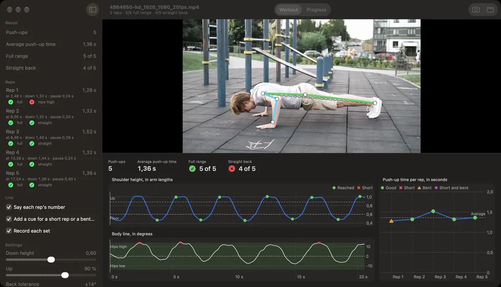

<h1 align="center">PushUpsMac</h1>

<p align="center">
  <b>Counts your push-ups as you do them, on your Mac.</b><br>
  An iPhone on the floor is the camera. Apple's Vision finds your body, and every rep is counted, timed and graded
  for full range and a straight back, out loud, as you go.
</p>

<p align="center">
  
  
  <a href="LICENSE"></a>
</p>

<p align="center">
  <a href="docs/guide.md">User guide</a> ·
  <a href="#get-started">Get started</a> ·
  <a href="#how-well-it-counts">How well it counts</a> ·
  <a href="#privacy">Privacy</a>
</p>



<p align="center"><sub>Demo footage: <a href="https://www.pexels.com/video/man-doing-push-ups-4964650/">olia danilevich on Pexels</a></sub></p>

## Features

- **Live counting.** Each rep is counted about a fifth of a second after you lock out, from an iPhone through
  Continuity Camera or any other camera the Mac sees.
- **Graded rep by rep.** Full range of motion, down to the floor and back up to straight arms, and a straight back,
  with no sagging or piked hips. Your near arm and body line are drawn on the picture.
- **Said out loud.** The Mac says each rep's number, and what fell short: "not to the floor", "not back up", "hips
  low", "hips high".
- **Every set recorded.** The video and the poses it was counted with go to Movies › PushUpsMac, cut to the set
  itself, without the set-up or getting up, and the set reopens as a clip with the count and grades it had live.
- **Clips too.** Open a clip you filmed earlier and it's counted the same way, with charts of your elbow's angle,
  your body line and each rep's time following the playhead.
- **Your progress.** Every set in a history by day, week, month or year, beside this week against last, days in a
  row, and your form and pace over time and within a set. Remove a miscounted rep, delete or merge sets, and undo any
  of it.
- **Counted off your elbow.** A rep is your elbow bending and straightening again, so nothing is measured off your
  body first, and walking into position doesn't throw the count off. Change how straight your back must stay, and the
  set is graded again at once.

<!-- Screenshot: a live set in progress: the camera's picture with the overlay on the body, the reps in the sidebar, and the panel's charts under the picture -->

The [user guide](docs/guide.md) takes you through a live set, opening a clip, the Progress tab and every setting.

## How well it counts

The test clips are seven sets by one person, graded by hand. Six were filmed on an iPhone as
[Film yourself](#film-yourself) says: a clean set facing each way, hips sagging, hips piked, half reps and fast reps.
The seventh was recorded by the app itself, from setting the phone down and walking into the plank. With the default
settings:

| | By hand | PushUpsMac |
|---|---|---|
| Push-ups | 26 | 26 |
| Range of motion | 24 full, 2 half | 25 of 26 graded the same |
| Back | 20 straight, 6 bent | 25 of 26 graded the same |

The two it grades differently sit just past the cut-offs. One full rep's elbow bent to 120°, against the 115° that
counts as the floor, and one straight back read −15.4°, against a tolerance of 14°. The angles were set on
the six iPhone clips, so they may suit their one person best. If your back grades look off, the
[user guide](docs/guide.md#settings) says which setting to change.

On a MacBook Pro with an M1 Pro:

| | How long |
|---|---|
| Live, iPhone at 1280 × 720 | Vision takes 24–27 ms a frame, and each rep is counted 0.19–0.22 s after you lock out |
| A clip's first opening | Vision goes through every frame: 17 s for the demo's 20.6 s clip (1080p, 25 fps), and about twice as long as it plays for a 4K clip at 60 fps |
| The same clip again, also after you quit | 0.1 s |

## Privacy

Everything stays on your Mac:

- **Vision runs on the Mac.** Nothing is uploaded; the app has no network access at all.
- **No account or sign-in.**
- **The camera is used only while Camera is on.** Its picture goes nowhere but the screen and, with Record each set on,
  the recording in Movies › PushUpsMac.
- **The app opens only the clips you give it.** It writes only to its own folder and Movies › PushUpsMac, and moves
  a deleted set's recording to the Trash.

This repository holds no video of its test clips either. The tests use stick figures (Vision's joints for each frame
of seven clips) and counts in `golden/`. The clips themselves stay on the Mac they were filmed for. The demo at the top
is a stock clip from Pexels.

## Get started

### What you need

- **A Mac with macOS 27 or newer.**
- **Xcode 27**, to build the app.
- **A camera:** an iPhone used through Continuity Camera, or any other camera the Mac sees (the built-in camera, or
  one plugged in).
- **Floor space** for a push-up, and for the phone beside you, far enough away to see all of you.

### Build and run

1. Clone the repository:

   ```bash
   git clone https://github.com/nainajnahO/PushUpsMac.git
   ```

2. Open `PushUpsMac.xcodeproj` in Xcode.
3. Pick your own team: select the **PushUpsMac** target, then **Signing & Capabilities**, then **Team**. The project
   is set to its author's team, and Xcode signs the app for your Mac with yours.
4. Choose **Product › Run** (⌘R).

To build from Terminal instead, pass your team ID:

```bash
xcodebuild -project PushUpsMac.xcodeproj -scheme PushUpsMac -destination 'platform=macOS' DEVELOPMENT_TEAM=<your team ID> build
```

The first time you turn on the camera, macOS asks whether PushUpsMac may use it.

### Film yourself

The app sees you from one side, so the set-up matters more than anything else:

- **Landscape:** turn the iPhone on its side.
- **On the floor:** stand the phone on the floor, at your level, not on a table looking down.
- **Side-on:** put it beside you, opposite your middle, facing your side. Facing left or right both work.
- **Your whole body in frame:** hands to feet, from the top of the push-up to the bottom. Move the phone back until
  all of you fits, with some room to spare.

<!-- Screenshot: the camera's picture of a good set-up: side-on at floor level, the whole body in frame, the overlay on the near arm and the body line -->

The counting and the default settings were set on six clips of one person filmed this way. If your camera stands elsewhere, or the
grades don't match what you did, see the [user guide](docs/guide.md#every-setting).

Then turn on the camera and do a set: the [user guide](docs/guide.md#count-a-live-set) takes it from there.

## For developers

| Path | What |
|---|---|
| `App/` | The SwiftUI app |
| `Engine/` | The `PushUpsEngine` Swift package (video, pose, analysis, tests) and the `pushups-cli` tool |
| `golden/` | Vision's keypoints for each test clip and the counts they're held to, for the tests (no video) |
| `docs/` | The user guide, and the demo on this page |

To run the engine's tests:

```bash
cd Engine && swift test
```

The tests that read the clips themselves are skipped without them, since the clips aren't in the repository.
[PLAN.md](PLAN.md) has the plan and the decisions behind it, and the [issues](../../issues) track the work.

## Credits and licence

Inspired by the [push-ups demo](https://github.com/jeremyipark/vision-demos/tree/main/push_ups) in
[vision-demos](https://github.com/jeremyipark/vision-demos) by Jeremy Park, licensed under Apache-2.0. The method
(counting reps from a pose model's joints, timing each rep's phases, and grading its range of motion and body line)
comes from it; PushUpsMac counts off the elbow's angle where the demo uses the shoulder's height. PushUpsMac is
licensed under Apache-2.0 as well (see [LICENSE](LICENSE)).

The demo at the top is made from [a clip by olia danilevich](https://www.pexels.com/video/man-doing-push-ups-4964650/)
on Pexels, under the [Pexels License](https://www.pexels.com/license/).
